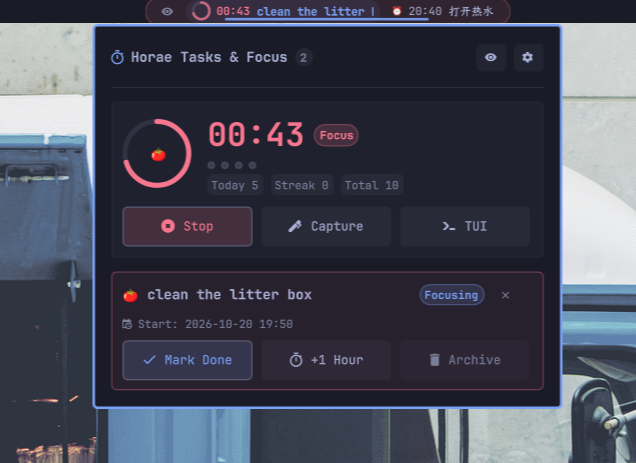

# Horae Tasks & Pomodoro

[English](README.md) | 简体中文



[Omarchy](https://omarchy.org/) Quattro 状态栏（bar）组件：将 [Horae](https://github.com/zhaohang1205/horae) 的即将到期 / 逾期 GTD 任务与番茄钟专注状态直接呈现在 bar 上，点击即可快捷操作，无需离开当前工作流或单独打开终端。

## 功能特性

- **🔒 状态栏隐私模式**：状态栏支持一键切换隐私模式（鼠标悬停组件时在最左侧呼出 `󰈈` / `󰈉` 图标，平时自动隐身不占空间；也可在面板顶部或设置中切换）。开启后，状态栏上的任务标题与正在专注的番茄钟任务**仅暴露首字**（中文如“铲…”）或**首个单词**（英文如“meeting…”），在公共办公、会议投屏或直播分享屏幕时有效防止敏感日程泄露。
- **闪念快速录入**：左击状态栏番茄钟图标 `🍅`（平时随分隔符隐身，鼠标悬停时在最右侧呼出，运行中/无任务时常驻），立即在浮动终端中唤出 Horae 原生闪念录入窗口（`horae --flash`）。享受终端内完整的语法高亮、动态卡槽提示（`[*周期] [~时间] [!优先级] [@标签]`）与标签补全，敲击回车即可自动保存至收件箱并秒级退出！
- **🍅 番茄钟参数配置**：无需进入终端命令行，点击面板顶部的 `⚙` 或底部设置按钮即可展开配置面板：
  - 专注工作时长（默认 25 分钟，支持快捷选择 15m / 25m / 45m / 50m 或微调步进）
  - 短休时长（默认 5 分钟，支持 3m / 5m / 10m / 15m）
  - 长休时长（默认 15 分钟，支持 10m / 15m / 20m / 30m）
  - 长休间隔周期（默认 4 轮，支持 2 / 3 / 4 / 5 轮）
  - 修改即时同步并保存至 `~/.config/horae/pomo.json`，与 Horae 核心引擎无缝互通。
- **即时任务流**：直接呈现由 Horae 引擎计算的即将到期与计划任务窗口。
- **番茄钟专注指示**：正在番茄钟专注的任务会自动用 🍅 固定到最前，并带动态呼吸闪烁与秒级倒计时。
- **一键快捷操作面板**：点击状态栏任务项展开操作面板：
  - 🍅 **开启番茄钟**：直接在该任务上启动番茄钟。
  - ⏱️ **延迟 1h**：将任务日程顺延 1 小时。
  - ✅ **完成**：标记任务已完成（正在专注时自动停用番茄钟）。
  - 📦 **归档**：将任务软删除归档。
  - ⚡ **+ 闪念录入**：面板内快捷拉起 `horae --flash`。
  - ⚙️ **番茄设置**：直接切换到番茄钟与插件设置面板。
  - 🖥️ **打开 TUI**：一键进入 Horae TUI 终端全功能面板。
- **悬停跑马灯**：标题超出宽度时，悬停鼠标自动平滑横向滚动，平时保持沉浸简洁。
- **番茄钟与 TUI 深度联动**：左击番茄钟图标打开快速录入（`horae --flash`），右击直接唤出或聚焦 Horae TUI 终端窗口（`omarchy-launch-or-focus-tui horae`）；双击停止番茄钟。
- **原生双语支持**：右上角配备滑动开关，支持中/英一键即时无缝切换。
- **事件驱动极低开销**：通过文件监听 `horae.db` 与 `pomo.json`，实现毫秒级即时同步与无轮询低能耗。

## 前置依赖

- Omarchy Quattro shell
- 已安装 [Horae](https://github.com/zhaohang1205/horae) CLI 工具：
  ```bash
  cargo install --git https://github.com/zhaohang1205/horae.git --rev ef187817ec29411907aed5366a26b1167aaf417e
  ```

## 安装

```bash
omarchy plugin add https://github.com/zhaohang1205/horae_for_omarchy_shell.git --enable
```

## 状态栏位置调整

将组件移动到状态栏的中部或右侧：

```bash
omarchy bar move io.github.zhaohang1205.horae-tasks --section center
```

或者在 `~/.config/omarchy/shell.json` 的 `bar.layout` 中进行配置：

```json
{
  "id": "io.github.zhaohang1205.horae-tasks",
  "maxWidth": 420
}
```

## 设置选项

可以在 `~/.config/omarchy/shell.json` 针对该组件项配置以下参数：

| 参数 | 类型 | 默认值 | 说明 |
|---|---|---|---|
| `horaeBin` | string | `"~/.cargo/bin/horae"` | `horae` 可执行文件路径 |
| `dataDir` | string | `"~/.config/horae"` | 存放 `pomo.json` 与 `horae.db` 的数据目录 |
| `profile` | string | `""` | 指定 Horae profile 数据集 |
| `limit` | number | `10` | 查询候选任务数上限 |
| `displayMax` | number | `2` | 状态栏同时展示的任务数量 |
| `maxWidth` | number | `420` | 组件在状态栏上的最大逻辑像素宽度 |
| `alwaysShow` | boolean | `true` | 无待办任务时是否常驻显示番茄钟驻留入口 |
| `textColor` | string | `""` | 自定义文本颜色（默认继承状态栏前景色） |
| `privacyMode` | boolean | `false` | 隐私模式（开启后仅暴露任务首字/单词） |
| `lang` | string | `""` | 语言设置（`"zh"` 或 `"en"`，留空自动检测系统语言） |

## 推荐窗口规则（Hyprland 弹窗配置）

为了让闪念录入窗口（`horae --flash`）以精致、居中的浮动小弹窗尺寸呈现，推荐在 `~/.config/hypr/hyprland.lua` 中添加：

```lua
-- Horae 闪念快速录入居中紧凑小弹窗
o.window("^org\\.omarchy\\.horae-flash$", {
	float = true,
	center = true,
	size = { 760, 360 },
})
```

## Quattro Shell 指令

支持通过 Omarchy Quattro shell 命令行唤出或收起面板：

```bash
omarchy-shell shell summon io.github.zhaohang1205.horae-tasks '{}'
omarchy-shell shell hide io.github.zhaohang1205.horae-tasks
```

## 卸载

```bash
omarchy plugin remove io.github.zhaohang1205.horae-tasks
```

## 开源许可

[MIT](LICENSE) © 2026 alex zhao
